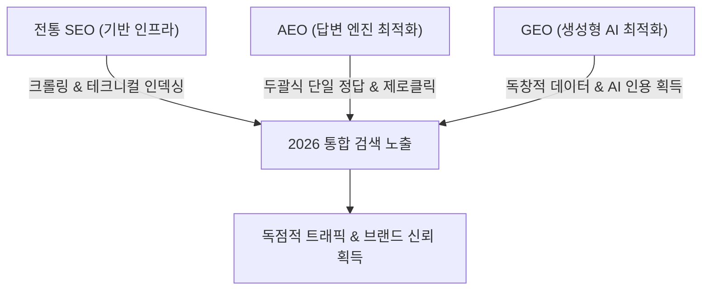
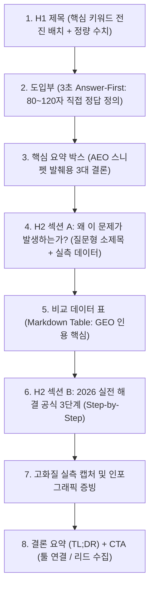

# 🌐 2026 SEO · GEO · AEO 콘텐츠 작성 올인원 마스터 가이드 (A to Z)

> **문서 목적:** 전통 검색엔진(구글/네이버 SEO) 상위노출, 생성형 AI 검색(ChatGPT/Perplexity/Google AI Overviews - GEO) 인용 점유, 답변 엔진(추천 스니펫/지식스니펫 - AEO) 직접 정답 채택을 단 한 편의 글로 동시에 달성하기 위한 2026년 표준 실전 집필 매뉴얼입니다.

---

## 🧭 [제1부] 거시적 관점: 검색 패러다임의 3대 축 (SEO vs AEO vs GEO)

과거의 검색이 **"키워드가 일치하는 웹페이지 10개의 파란색 링크 목록을 주는 것"**이었다면, 2026년의 검색은 **"사용자의 복잡한 의도를 해석하여 단 하나의 정답을 요약·생성·추천하는 것"**으로 완전히 전환되었습니다.

| 구분 | **SEO (Search Engine Optimization)** | **AEO (Answer Engine Optimization)** | **GEO (Generative Engine Optimization)** |
| :--- | :--- | :--- | :--- |
| **주요 대상** | 구글봇(Googlebot), 네이버 예티(Yeti) | 구글 추천 스니펫, 네이버 지식스니펫, AI 오디오/음성 검색 | ChatGPT Search, Perplexity, Google AI Overviews / AI Mode, **네이버 AI 브리핑**, Claude |
| **노출 형태** | 검색 결과(SERP) 1~10위 파란색 웹문서 링크 | 검색창 최상단 단독 강조 박스 (Featured Snippet) | AI가 작성한 종합 리포트 본문 내 **'출처(Citation)' 및 추천 브랜드** |
| **핵심 목표** | 높은 클릭률(CTR) 및 유기적 트래픽 유입 | 질문에 대한 1초 내 즉답 제공 (제로클릭 장악) | AI의 답변 합성(Synthesis) 시 필수 인용 출처로 채택 |
| **평가 기준** | 키워드 적합도, 백링크, 페이지 속도, 모바일 최적화 | Q&A 형식, 정의형 문장, 한글 120~200자(영문 40~60단어) 두괄식 요약, 리스트 | **Information Gain(정보 이득), 1차 실측 데이터, 비교 테이블** |

> 💡 **거시적 핵심 결론:**  
> **"SEO 기반이 부실한 문서는 GEO/AEO에서도 인용되기 어렵습니다."**  
> Google Search Central 공식 문서(*Optimizing your website for generative AI features on Google Search*)는 AI Overviews·AI Mode가 **기존 검색 순위 시스템으로 문서를 불러와(RAG/Grounding) 답변을 생성**하며, AI 검색을 위한 별도의 비법이나 전용 마크업은 없다고 밝힙니다. ChatGPT Search 역시 Bing 색인을 기반으로 하며, 업계 분석(Seer Interactive 등)에서는 ChatGPT 인용의 약 85% 내외가 Bing 상위 20위 문서와 겹치는 것으로 보고되었습니다.  
> 즉, **SEO(기술적 뼈대) + AEO(두괄식 정답 구조) + GEO(독창적 데이터 근거)** 3박자가 결합되어야 합니다.

---

## 📏 [제2부] 2026 최신 글쓰기 A to Z 규격 (글자수·사진·구조)

### 1. 📝 최적 글자 수 (Character Count) 표준

> [!NOTE]
> 구글과 네이버 모두 **"상위노출을 위한 공식 글자 수 기준은 없다"**고 안내합니다. 아래 수치는 검색 의도를 충족하기 위한 **PostSync 내부 권장치**이며, 순위 보장 조건이 아닙니다. 기준은 언제나 "질문을 해결하는 데 필요한 만큼"입니다.

과거의 "무조건 3,000자 이상 길게 쓰기"처럼 분량 자체를 목표로 삼으면, 같은 말 반복과 키워드 남발(Stuffing)로 이어져 문서 품질 평가에 불리해집니다.

* **표준 정보성 칼럼 / 실전 가이드 (가장 권장):** **공백 포함 1,800자 ~ 2,600자** (A4 1.5~2장 분량)
  - 네이버 스마트블록과 구글 검색 모두에서 '충실한 정보 밀도'를 인정받는 가장 이상적인 구간입니다.
* **전문직 심층 칼럼 / 딥다이브 필러 콘텐츠:** **공백 포함 2,800자 ~ 4,000자**
  - 판례 분석, 세법 개정안, 4대 지표 정량 비교 등 데이터와 테이블이 다수 포함되는 고단가 주제에 적용합니다.
* **단순 FAQ / 단답형 정의 글:** **공백 포함 800자 ~ 1,200자**
* ⚠️ **절대 금기:** 분량을 채우기 위해 인사말, 날씨 이야기, 같은 말 반복 등 무의미한 문장으로 분량을 뻥튀기하지 마십시오. 검색엔진과 AI 요약 엔진은 분량이 아니라 **문서가 담은 정보의 밀도와 고유성**을 기준으로 인용할 문서를 고릅니다.

---

### 2. 🖼️ 사진 규격 (품질, 장수, 포맷, 이미지 SEO)

2026년 검색엔진은 이미지 인식 기술을 활용하지만, **이미지 속 글자와 수치를 본문만큼 정확하게 읽어 인용한다는 보장은 없습니다.** 네이버도 이미지에 담긴 핵심 정보를 본문 텍스트로 함께 작성하라고 안내합니다.

* **텍스트 병기 원칙 (필수):** 캡처·인포그래픽에 담긴 핵심 수치와 결론은 이미지 바로 위나 아래에 **1~2문장의 본문 텍스트로 반드시 다시 서술**하십시오. 이미지에만 있는 정보는 AI 브리핑·AI Overviews 인용 대상에서 빠질 수 있습니다.

* **최적 사진 장수 (내부 권장치):** 본문당 **4장 ~ 7장 내외**
  - 장수 자체는 순위 요인이 아닙니다. 다만 본문과 무관한 감성 스톡 사진 20~30장을 도배하면 페이지 로딩 속도(LCP)가 나빠지고 문서의 관련성도 떨어집니다.
* **사진의 품질 및 내용 원칙 (Context is King):**
  - ❌ **금지:** 핀터레스트, 언스플래시에서 긁어온 본문과 무관한 배경 사진, 단순 아이콘 나열.
  - ✅ **필수 (AI가 선호하는 4대 이미지):**
    1. **실제 데이터/순위 화면 캡처:** (예: PostSync 툴에서 실측한 1위 vs 2위 비교 화면)
    2. **자체 제작 벤토/인포그래픽 카드:** 핵심 수치나 프로세스를 요약한 시각 자료
    3. **비교 대조 다이어그램:** (잘못된 예시 vs 올바른 예시)
    4. **공식 문서/통계 증빙 캡처:** (공식 발표 자료, 네이버 공지 등)
* **이미지 기술 규격:**
  - **포맷:** **WebP 권장** (또는 압축된 고화질 JPG / 텍스트가 많은 캡처는 PNG)
  - **용량:** 장당 **150KB ~ 250KB 이하**로 압축 유지
  - **해상도/비율:** 가로 1200px 이상 (권장 비율: 16:9 가로형 또는 1080x1080 정방형)
* **이미지 SEO (크롤러 & AI 판독):**
  - 파일명: `image1.png`, `KakaoTalk_2026.jpg` 절대 금지 ➔ **영문 의미형 파일명** 적용  
    *(예: `naver-place-rank-gap-analysis.webp`, `smart-place-top1-setting-checklist.webp`)*
  - `alt` 텍스트: 이미지를 보지 못해도 무슨 내용인지 알 수 있는 1줄 설명 필수  
    *(예: `alt="네이버 스마트플레이스 1위 매장과 2위 매장의 영수증 리뷰 격차 분석 화면"`)*

---

### 3. 🏗️ 2026 글의 완벽한 구조 (The Inverted Pyramid 2.0)

모든 글은 **[결론 우선(AEO) ➔ 심층 근거 및 비교(GEO) ➔ 실전 적용 ➔ 행동 유도(SEO)]**의 역피라미드 구조를 준수해야 합니다.

#### ① H1 제목 (Title) 공식: [핵심 키워드 맨 앞] + [구체적 수치/연도] + [결과 혜택]
* 글자 수: **26자 ~ 34자 내외** (모바일 검색 결과창에서 말줄임표 `...` 방지)
* **공식 예시:**
  - ❌ 나쁜 예: *스마트플레이스 상위노출하는 법에 대해 알아봅시다.* (키워드 분산, 밋밋함)
  - ✅ 좋은 예: *2026 네이버 플레이스 순위 확인 사이트 활용법 (1위 매장 4대 격차 분석)*
  - ✅ 좋은 예: *세무사 블로그 마케팅 실패 원인 3가지와 고단가 수임 전환 공식*

#### ② 도입부: 'Answer-First' (첫 문단 안에 즉각적 결론 제시)
* AI와 바쁜 독자는 서론을 읽지 않습니다. **첫 문단(80~120자, 모바일 기준 약 3줄) 안에 질문에 대한 정의와 결론을 바로 박아야 합니다.**
* **작성 템플릿:**
  > "[질문/키워드]의 핵심 결론은 **[핵심 답변]**입니다. 2026년 기준 검색엔진이 순위를 결정하는 결정적 요인은 크게 ① [원인 1], ② [원인 2], ③ [원인 3]의 3가지로 압축됩니다."

#### ③ H2 / H3 소제목: '대화형 롱테일 질문(Conversational Query)' 형태
* 사용자가 AI(Perplexity, ChatGPT)나 구글 검색창에 묻는 실제 질문을 소제목으로 삼습니다.
  - ❌ *상위노출 팁* ➔ ✅ *Q. 영수증 리뷰가 1위 매장보다 많은데 왜 순위는 더 낮을까?*
  - ❌ *광고법 주의점* ➔ ✅ *2026 변호사 광고 규정에서 '승소율 100%' 문구가 형사처벌 대상인 이유*
* ⚠️ **과용 금지:** 모든 소제목을 질문형으로 바꾸거나, AI용으로 글을 한두 문장 단위로 잘게 쪼개지 마십시오. Google(Danny Sullivan)은 LLM을 위한 인위적 쪼개기(chunking)를 **"원하지 않는다"**고 공식적으로 밝혔습니다. 질문형은 핵심 소제목 2~3개에만 쓰고, 나머지는 사람이 읽기 자연스러운 서술형으로 둡니다.

#### ④ 본문 핵심: 비교 테이블 (Markdown Table) 필수 삽입
* **비교 데이터는 표(Table)로 정리하십시오.** 업계 분석에서 Google AI Overviews 답변의 약 78%가 리스트를 포함하고, 비교·가격·사양 질문에서는 표 형식 데이터가 자주 인용되는 것으로 보고되었습니다. 표는 반드시 이미지가 아닌 **HTML `<table>`(또는 마크다운 표)** 텍스트로 넣어야 합니다.
* *예시: 1위 매장 vs 하위 매장 비교표, 알고리즘 변경 전후 비교표, 가격/지표 비교표*

#### ⑤ 결론부: 요약(TL;DR) 및 내부 순환 링크(Internal Loop CTA)
* 본문 요약 3줄 불릿 포인트.
* 독자가 다음 행동을 할 수 있는 자연스러운 연결:
  - *"내 매장 실시간 순위와 1위 격차가 궁금하다면? ➔ [PostSync 플레이스 순위 무료 조회기] 바로가기"*
  - 관련 칼럼 추천 2개 링크.

---

## 🎯 [제3부] AI 엔진(GEO)과 답변 봇(AEO)을 사로잡는 5대 킬러 테크닉

### 1. Information Gain (정보 이득) 원칙
* 다른 블로그 10편을 읽고 짜깁기한 글은 AI 검색에서 '중복 정보'로 취급되어 완전히 배제됩니다.
* **해결책:** "우리가 2026년 10월 실제 강남역/서초 상권 매장 50곳을 실측 조사한 결과...", "실제 1위 매장 데이터 분석 결과..."처럼 **오직 내 글에만 존재하는 1차 데이터(First-party Data)와 정량적 수치**를 반드시 1개 이상 포함하십시오.

### 2. Entity-Based Writing (명확한 개체명 서술)
* AI는 모호한 대명사("그것", "이곳", "이 방법")를 이해하지 못합니다.
* 문장마다 주어와 고유명사를 정확하게 서술하십시오:
  - ❌ *"그것을 세팅하면 순위가 올라갑니다."*
  - ✅ *"네이버 스마트플레이스 관리자 센터에서 '네이버 예약'과 '플레이스 쿠폰'을 연동하면, 예약 필터 검색에 노출되고 예약자 리뷰가 쌓여 플레이스 순위에 유리한 고객 반응 데이터가 늘어납니다."*
  - ⚠️ **용어 주의:** C-Rank는 블로그·포스트 등 **콘텐츠 출처의 신뢰도를 평가하는 로직**이며, 스마트플레이스 순위 로직과는 별개입니다. 플레이스 글에서 "C-Rank 점수 가산" 같은 표현을 쓰지 마십시오.

### 3. 통계 및 권위 있는 출처 인용 (Quotations & Stats)
* 숫자가 없는 글은 AI에게 공허한 잡담입니다.
* 구체적 수치를 제시하십시오: "방문자 리뷰 1,565개 부족", "모바일 검색 비중 82%", "월간 검색량 81,100건", "전환율 3배 개선".
* Princeton 대학 등의 GEO 연구(2023)에서는 통계 수치·인용문·출처 표기를 추가한 문서가 생성형 엔진 답변에서 **최대 약 40% 더 많이 노출**되는 것으로 나타났습니다.
* ⚠️ **수치에는 반드시 출처나 측정 조건(기간·표본·도구)을 함께 적으십시오.** 출처 없는 수치는 신뢰 신호가 아니라 위험 요소이며, 전문직 콘텐츠에서는 광고 규정 위반 소지가 될 수 있습니다.

### 4. Definition Box (정의 박스)
* 핵심 개념이나 알고리즘을 설명할 때 인용구(`>`)를 사용하여 2문장으로 깔끔하게 정의하십시오. 독립적으로 읽혀도 뜻이 통하는 짧은 정의 문단은 추천 스니펫·AI 답변에 발췌되기 쉽습니다(채택이 보장되지는 않습니다).

### 5. 구조화 데이터 (Schema Markup) 지원 — 2026년 기준 재정리
* **현재 권장:** 칼럼에는 `Article`(또는 `BlogPosting`) + 저자 정보(`author` → `Person`, 자격·프로필 URL 포함), 사이트 전체에는 `Organization`을 적용합니다. 누가 쓴 글인지 명확히 하는 것이 전문직 콘텐츠의 신뢰 신호입니다.
* ⚠️ **`HowTo` 리치결과는 2023년 9월, `FAQPage` 리치결과는 2026년 5월 7일 구글에서 전면 종료되었습니다.** 기존 마크업을 남겨 두어도 불이익은 없지만, 구글 검색 화면에 추가 노출 효과는 없습니다. 리치결과를 노리고 FAQ를 억지로 끼워 넣지 마십시오.
* 본문 속 Q&A 문단 자체는 독자와 AI 답변에 여전히 유용하므로, 마크업과 상관없이 **내용으로서의 FAQ**는 필요한 경우 유지합니다.
* 스키마만 추가하고 본문 품질이 낮으면 효과가 거의 없습니다. AI 검색 노출을 위한 전용 마크업이나 메타 태그는 존재하지 않습니다(Google 공식).

---

## 📋 [제4부] 글 발행 전 최종 13대 셀프 체크리스트

글을 완성한 후 발행하기 전, 다음 13개 문항을 체크하십시오.

| 번호 | 체크 항목 | 충족 여부 | 점검 포인트 |
| :---: | :--- | :---: | :--- |
| **01** | **제목 키워드 전진 배치** | [ ] | 핵심 타깃 키워드가 제목 앞 1/3 안에 위치하는가? |
| **02** | **Answer-First 도입부** | [ ] | 첫 문단(80~120자) 안에 질문에 대한 명확한 결론이 있는가? |
| **03** | **글자 수 적정성** | [ ] | 내부 권장치(공백 포함 1,800~2,600자, 심층 2,800~4,000자)에 맞고, 분량 채우기용 문장이 없는가? |
| **04** | **소제목 질문형(H2)** | [ ] | 핵심 소제목 2~3개가 소비자가 실제로 묻는 대화형 질문으로 쓰였는가? (전부 질문형은 지양) |
| **05** | **비교 테이블 포함** | [ ] | 이미지가 아닌 텍스트 표(HTML/마크다운)로 된 비교표가 1개 이상 있는가? |
| **06** | **독창적 데이터(GEO)** | [ ] | 다른 곳에 없는 실측 수치나 실제 사례가 포함되었고, 수치마다 출처·측정 조건이 적혀 있는가? |
| **07** | **사진 맥락 및 텍스트 병기** | [ ] | 본문과 직결되는 캡처/인포그래픽(4~7장 권장)이며, 이미지 속 핵심 정보가 본문 텍스트로도 서술되었는가? |
| **08** | **이미지 파일명/alt** | [ ] | 파일명이 영문 키워드이며, alt 설명이 구체적인가? |
| **09** | **단일 H1 태그 원칙** | [ ] | 본문 내 소제목으로 H1이 중복 사용되지 않고 H2/H3로 구성되었는가? |
| **10** | **내부 링크 & CTA** | [ ] | 관련 무료 웹툴(`/place` 등)이나 다음 칼럼으로 이어지는 링크가 있는가? |
| **11** | **저자 정보** | [ ] | 실명·자격·프로필이 표시되고 `Article` + `author` 스키마가 연결되었는가? |
| **12** | **사람 검수** | [ ] | AI 초안을 사람이 사실 확인·경험 보강했으며, 전문직 광고 금칙어가 없는가? |
| **13** | **용어·스키마 최신성** | [ ] | 종료된 리치결과(FAQ/HowTo)를 노린 구성이나 C-Rank 같은 용어 오용이 없는가? |

---

## 🔧 [제5부] 글 밖에서 챙겨야 할 기술 인프라 & 외부 신호

글을 잘 써도 아래 조건이 빠지면 AI 검색에서 인용되지 않습니다. 이 항목들은 글 작성자가 아니라 **사이트 운영 담당자**가 분기마다 점검합니다.

### 1. AI 크롤러 허용 (`robots.txt`)
* `Googlebot`, `Bingbot`, `OAI-SearchBot`(ChatGPT 검색), `PerplexityBot`을 차단하지 않았는지 확인합니다. 막혀 있으면 아무리 좋은 글도 AI 답변에 인용될 수 없습니다.
* 학습용 크롤러(`GPTBot` 등) 허용 여부는 별도 정책으로 결정합니다. 검색 인용용 크롤러와 구분하십시오.

### 2. Bing 색인 등록
* ChatGPT Search는 Bing 색인을 기반으로 합니다. **Bing Webmaster Tools에 사이트맵을 등록**하지 않으면 ChatGPT 인용에서 불리합니다. (네이버 서치어드바이저·Google Search Console 등록과 별개로 진행)

### 3. 사이트 밖 브랜드 언급 (Off-site Signals)
* 업계 연구(Ahrefs, Semrush 등)에서는 AI 답변에 어떤 브랜드가 추천될지가 **제3자 사이트(커뮤니티, 언론, 리뷰 사이트)에서의 언급량**과 강하게 연관되는 것으로 나타났습니다.
* 우리 사이트 글만으로는 부족합니다. 관련 커뮤니티의 실제 질문에 정직하게 답하고, 1차 데이터를 업계 매체에 기고하는 방식으로 언급을 확보합니다. (광고성 도배·자작 후기는 금지)

### 4. 네이버 생태계 기준
* **D.I.A.+:** 직접 겪은 경험, 구체적 수치, 대안 비교, 주의사항 등 경험 정보가 담긴 문서를 우대합니다.
* **C-Rank:** 블로그가 특정 주제를 일관되게 다루는지(주제 전문성)를 평가합니다. 한 블로그에서 주제를 무분별하게 섞지 마십시오.
* **AI 브리핑:** 질문에 대한 즉답형 첫 문단 + 텍스트로 풀어 쓴 근거가 인용에 유리합니다.

### 5. 효과 없는 작업 (하지 말 것)
* ❌ **`llms.txt` 파일:** Google은 사용하지 않는다고 밝혔고, SE Ranking의 약 30만 도메인 분석에서도 AI 인용과 상관관계가 없었습니다. 개발 문서 사이트가 아니라면 우선순위에서 제외합니다.
* ❌ **AI 글 대량 발행:** 사람의 검수와 1차 데이터 없이 AI 글을 대량으로 찍어내면 Google 스팸 정책(Scaled Content Abuse) 위반 대상이 되고, 네이버에서도 저품질로 걸러집니다.
* ❌ **하위 질문마다 얇은 페이지 만들기:** AI 검색의 하위 질문 확장(Query Fan-out)을 노려 비슷한 얇은 페이지를 양산하는 것도 같은 스팸 정책 위반 소지가 있습니다.

### 6. 측정
* **Google Search Console**의 생성형 AI 기능 실적 보고서(베타, 순차 제공)로 AI Overviews·AI Mode 노출을 확인합니다.
* 핵심 질문 10~20개를 정해 ChatGPT·Perplexity·네이버 AI 브리핑에서 **월 1회 직접 검색해 인용 여부를 기록**합니다. AI 답변은 매번 달라지므로 1회 결과로 판단하지 마십시오.

> [!NOTE]
> 2026년 GEO 관련 수치는 대부분 업체 자체 연구라 연구마다 차이가 큽니다(예: AI Overviews 인용 문서 중 구글 상위 10위 문서 비율 38~52%). 본 문서의 수치는 방향을 잡는 참고치로만 사용하고, 분기마다 재점검합니다.

---

*작성 일자: 2026년 10월 23일 (1차 검수·개정: 2026년 10월 23일)*  
*관리 기준: PostSync AI 마케팅 데이터 연구소 2026 검색 컴플라이언스 표준*
